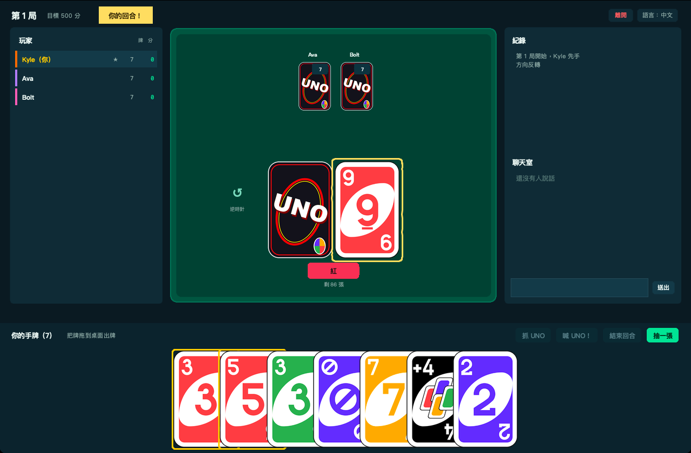
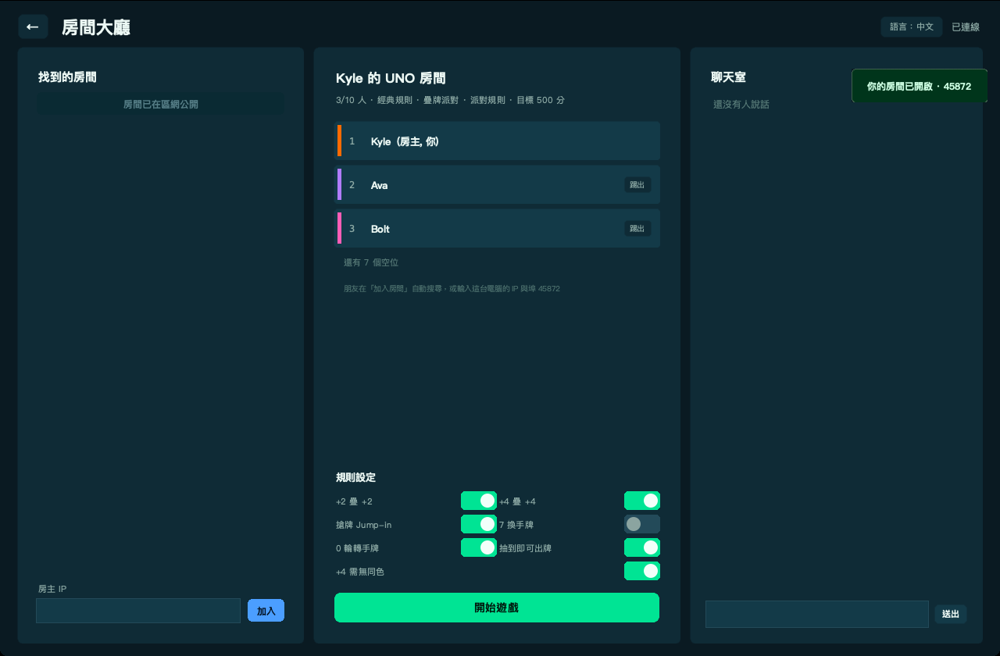
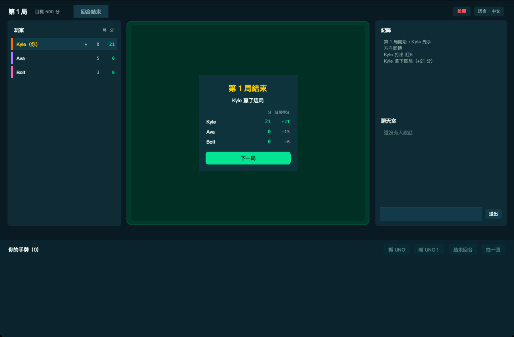
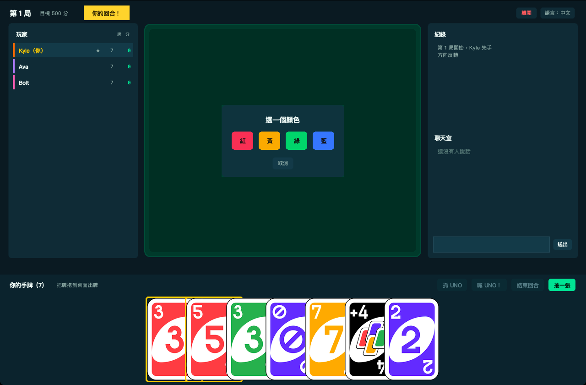
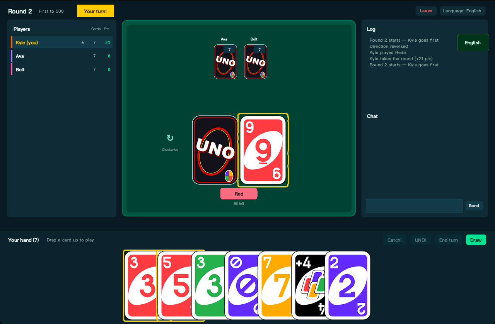

# UNO — LAN party table

Classic UNO for **2–10 players** on the same Wi-Fi. Python 3.10+,
Tkinter, **standard library only** — no server, no account, no internet,
no bots: every seat is a real person.

  



## Features

- **LAN rooms** — host a table on your network; other players find it
  automatically over UDP broadcast, or join by typing the host IP. The host
  machine runs the authoritative game loop; clients only send intents.
- **Up to 10 players + 8 spectators** — spectate a running game, chat with the
  table, drop out and rejoin. If a disconnected player's turn comes up, the
  host auto-draws and passes for them after 12 s so the table never stalls;
  their seat is restored by the reconnect token when they return.
- **Full ruleset** — colour/value matching, skip, reverse, +2, wild, wild +4,
  colour picking, draw-and-play, reshuffle.
- **House rules, all toggleable by the host** — stacking (+2 on +2, +4 on +4),
  jump-in, *7 swaps hands* (off by default), *0 rotates hands*, wild +4 only
  without a matching colour, and whether a drawn card may be played immediately.
- **Same-number combo (house rule, off by default)** — on your turn select a number card that has
  twins of the same value in your hand and press **▶ Play ×N** (next to *Sort hand*): all of them
  go onto the pile in one turn. The first card has to be legal; the card you selected goes last when
  it can, so its colour becomes the new colour. Number cards only — no action or wild cards, no 7
  while *7 swaps* is on, no 0 while *0 rotates* is on, and no combo after drawing or while a
  +2/+4 penalty is pending. Going out with a combo wins the round as usual.
- **Turn timer (optional)** — the host picks *Off / 60 / 30 / 15 s* in the lobby. Every turn gets a
  fresh countdown (bar + seconds in the turn banner on the computer, a bar under the header on the
  phone; it turns red for the last 5 s). When it runs out the player automatically draws one card
  and passes (a stacked +2/+4 penalty is taken instead). Drawing a playable card gives a fresh
  countdown to decide; the clock is paused while a swap target is being chosen and idle between
  rounds. Off by default.
- **UNO call & catch** — when someone is down to one card a countdown bar
  opens: they must press **UNO!** (or take +2), anyone else may press
  **Catch!** to punish a forgetful player.
- **Emoji reactions** — press **😊** in the table header (desktop or phone/browser) and pick one of
  eight emoji; it floats up over your seat for everyone at the table. One reaction per player per
  1.2 s; spectators watch but cannot send.
- **Score to 500** — hand points (number = face value, action = 20, wild = 50)
  are awarded to the round winner; rematch keeps cumulative score and wins.
- **Bilingual UI** — Traditional Chinese / English, switchable live from the
  menu or in-game; the choice is remembered between runs.
- **Adjustable columns** — every screen is three columns: drag the divider to
  grow the table, press **✕** to fold a side column away, click the tab on the
  edge to bring it back (double-click a divider to reset it). Column widths and
  folded state are remembered between runs, in both the lobby and the table.
  Inside the table's right column *Log* and *Chat* are stacked with their own
  divider, so the log can grow while you are reading it.
- **Real card art** — the 108-card deck is rendered once from a vector sheet
  into crisp PNGs (`tools/build_cards.py`); the game itself only needs Tkinter.
- **Polished table** — cards fly to the pile, hands deal in with a stagger,
  the turn banner pulses, the UNO countdown chip drains live, and the table
  reflows cleanly from two players to ten, from 1040 px to full screen.

## Quick start

Needs **Python 3.10+ with Tkinter** — the python.org builds for macOS and
Windows include it; on Debian/Ubuntu install `python3-tk` (`sudo apt install
python3-tk`). Nothing else: no `pip install`, no venv, no server, no account.

```bash
git clone https://github.com/kyle2241345145351324321/uno.git
cd uno
python3 uno.py              # GUI: host a room or join one
```

**Host**: *Host a room* → the lobby appears with your room and its IP. Toggle
any house rule, press *Start game* when everyone has joined.

**Join**: *Join a room* → rooms found on the LAN are listed automatically,
or type the host IP and press *Join*. Press *Watch* to spectate instead.

```bash
python3 uno.py --host --name Kyle        # open a room immediately
python3 uno.py --join 192.168.1.7        # join a room immediately
python3 uno.py --join 192.168.1.7 --spectate
python3 uno.py --host --no-discovery     # hide from the room browser
python3 uno.py --lang en
python3 uno.py --host --no-web           # do not serve the phone/browser version
python3 uno.py --host --web-port 9000    # browser version on another port
```

Players on the same network only need this folder — no install step.

## Phone / browser version

When you host a room the program also serves a small web page, so friends
**without the program** (phones included) can play at the same table:

1. Host a room - press **📱 Phone / web** in the lobby (or in the game header).
2. It shows an address such as `http://192.168.1.7:8080/` and a QR code.
3. Anyone on the **same Wi-Fi** scans the code or types the address into a browser
   and joins as a player or spectator - nothing to install.

**Add to home screen.** On a phone or tablet the join page has an *Add to home screen* link
(also in the in-game menu) with step-by-step instructions for iPhone/iPad (Safari) and Android
(Chrome). Opened from the home screen the page runs full-screen with the UNO icon and no address bar.
The icon remembers the host's address, so if the host's IP changes (another Wi-Fi, router restart)
delete the icon and add it again. The room is plain `http://` on the LAN, so there is no offline mode.

Browser players are real seats at the host's table: same rules, chat, avatars,
reconnect (reload the page and you are back in your seat). Hosting-only actions
(rules, start, next round) stay on the host's computer. Use `--no-web` to turn
it off or `--web-port 9000` to change the port. If macOS asks whether Python may
accept incoming connections, choose **Allow**.

## Room password and join approval

In the host's lobby (**Room security**):

- **Room password** - anyone joining (program, phone or browser) must type it. Leave it empty for an open room.
- **Ask me before anyone joins** - every newcomer waits while a card appears in your window: **Allow** or **Deny**.

Players who are already seated and reconnect during a game are not asked again. The lock 🔒 shows in the room list.
Both settings are remembered until you close the program, so the next room you open keeps them.

If the window ever freezes, the program writes what every part was doing to `hang.log` (next to the preferences file) - send that file along with the bug report.

## Controls

| Action | How |
|---|---|
| Play a card | Drag it up onto the table (or click once to select, then drag) |
| Draw | **Draw** button (then drag the drawn card onto the table if you want to play it) |
| End turn after drawing | **End turn** button |
| Call UNO | **UNO!** button while your countdown is running |
| Catch someone | **Catch!** button while their countdown is running |
| Pick a colour | Click one of the four colour chips |
| Swap hands (7) | Click the opponent you want to swap with |
| Chat | Type in *Chat*, press Enter or *Send* |
| Resize a column | Drag the divider between two columns (double-click it to reset) |
| Fold a side column | **✕** in the column's top-right corner; click the tab on the window edge to unfold |
| Give the log more room | Drag the divider between *Log* and *Chat* (double-click it to reset) |
| Keyboard | **D** draw · **P** end turn · **U** UNO! · **C** catch · **Esc** cancel a colour pick |

## How a round works

1. Everyone gets 7 cards; the top card starts the discard pile. If it is an
   action card, its effect applies to the first player.
2. Match the top card by colour or value, or play a wild. Unplayable? Draw one
   card, then play it or pass.
3. Action cards: **Skip** skips the next player, **Reverse** flips direction
   (it acts as a skip in a two-player game), **+2** makes the next player draw
   two, **Wild** lets you choose the colour, **Wild +4** does both.
4. When a player plays their last card the round ends and they score the
   points left in every other hand. First to **500** wins the match; after that
   you can start a rematch with the same table.

House rules (host toggles in the lobby):

- **Stacking** — a +2 can be answered with another +2, a +4 with another +4;
  the accumulated penalty passes on until someone draws.
- **Jump-in** — holding a card identical to the top card lets you play it out
  of turn and take over the turn.
- **7 swaps** — playing a 7 swaps hands with a player of your choice
  (off by default).
- **0 rotates** — playing a 0 rotates every hand in the current direction.
- **Same-number combo** — see the feature list above.
- **Turn timer** — see the feature list above: when it expires the player draws one card and passes.
- **Wild +4 needs no colour match** — when on, +4 is always legal; when off,
  it may only be played if you hold no card of the current colour.

## Networking

- TCP **45872** for the game connection (host falls back to the next free port
  up to 45883 if it is taken), UDP **45871** for room discovery.
- The protocol is documented in [docs/PROTOCOL.md](docs/PROTOCOL.md):
  newline-delimited JSON, host-authoritative, per-seat snapshots so nobody can
  read another hand, plus chat/spectator/rematch messages.
- If your firewall blocks UDP broadcast, use *Join* with the host IP, or start
  with `--no-discovery` on the host.
- Seats have unique names: if two players enter the same name, the later joiner
  is renamed automatically (`Player` → `Player 2`) instead of being rejected.

## Layout

| File | Purpose |
|---|---|
| `engine.py` | Pure rules engine — deck, turns, stacking, UNO window, scoring, snapshots |
| `net.py` | UDP discovery + TCP JSON host server and client |
| `webserver.py` | Browser gateway: serves `web_client.html`, bridges each browser to the room |
| `web_client.html` | The phone/browser client (single file, no dependencies) |
| `avatars.py` | Photo avatars: crop to a circle, PNG transport, per-size rendering |
| `icons/` *(optional)* | Home-screen icons (192/512/180 px PNG) served with `/manifest.webmanifest`; when the folder is absent the four PNGs at the repo root are used instead |
| `qrcode_min.py` | Tiny QR-code generator used by the phone/web dialog |
| `ui.py` | Tkinter menu, lobby, table, chat, overlays |
| `panes.py` | Column container: draggable sashes, ✕ collapse, edge tabs, log/chat split |
| `prefs.py` | Tiny JSON preference store (`lang`, `layout.*`) |
| `i18n.py` | Chinese/English strings and card/error names |
| `cards.py` | Tk image cache for the rendered card PNGs |
| `tests/test_pwa.py` | Manifest, icon and home-screen link tests for the web gateway |
| `tests/test_combo.py` | Loopback tests for combo plays (wire format, refusals, privacy) |
| `tests/test_timer.py` | Loopback tests for the turn timer rule, broadcast and timeout |
| `tests/test_react.py` | Loopback tests for emoji reactions (broadcast, cooldown, validation) |
| `uno.py` | Entry point and command-line flags |
| `selftest.py` | Headless rule tests (`uno.py --selftest`) |
| `tests/test_net.py` | Loopback tests for the LAN layer |
| `tests/test_layout.py` | Column geometry, preference store, live Tk pane test |
| `tools/build_cards.py` | One-off renderer: vector sheet → `cards/*.png` + manifest |
| `docs/PROTOCOL.md` | Wire protocol specification |

The card PNGs in `cards/` are generated; `python3 tools/build_cards.py --sheet
<rendered sheet.png>` regenerates them (needs Pillow and Chrome for the
screenshot step, but never at play time).

## Tests

```bash
python3 uno.py --selftest          # 17 headless rule suites (134 checks)
python3 -m unittest discover -s tests -v   # engine, LAN loopback and layout tests (38 tests)
```

Preferences live in a small JSON file — `~/Library/Application Support/uno/prefs.json`
on macOS, `%APPDATA%\uno\prefs.json` on Windows, `~/.config/uno/prefs.json`
elsewhere; set `UNO_PREFS` to point somewhere else (handy for tests).

## Screenshots

| Lobby | Round over |
|---|---|
|  |  |

| Colour picker | English UI |
|---|---|
|  |  |

## Credits

Card faces were rendered once from a vector UNO deck sheet into the PNGs in
`cards/` (the sheet itself is not in this repo — the finished PNGs are, so
nothing has to be regenerated in order to play). Everything else — engine,
networking, browser client, UI — is original code in this folder.
